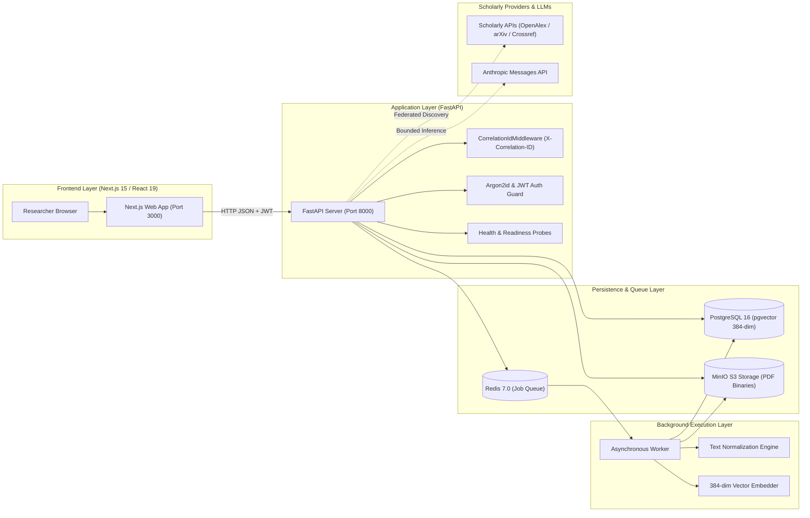

<div align="center">

# ResearchPilot AI
### Evidence-Backed AI Research Discovery & Paper Intelligence Platform

[](LICENSE)
[](https://python.org)
[](https://fastapi.tiangolo.com)
[](https://nextjs.org)
[](https://github.com/pgvector/pgvector)
[](https://redis.io)
[](https://min.io)
[](https://docker.com)
<p align="center">
  A full-stack research workspace for scientific-paper discovery, private PDF ingestion, evidence retrieval, and literature analysis.
</p>

[**Architecture**](#-system-architecture) • [**Capabilities**](#-features--capabilities) • [**Verification**](#-verification-status) • [**Quickstart**](#-quickstart--local-deployment)

</div>

---

## Verification Status

The repository contains working application code, but it has not been verified as production-ready. On 2026-10-29, the Next.js production build succeeded and 42 service-independent backend tests passed; the checked-in retrieval evaluation ran against its synthetic golden corpus. Database/API/worker integration could not be validated because Docker and its PostgreSQL, Redis, and MinIO services were unavailable. See the [current project review](docs/PROJECT_REVIEW.md) for exact commands, results, risks, and gaps.

The RAG evaluation measures retrieval and a rule-based evidence-support heuristic over three synthetic papers. It does **not** call an LLM and does not measure real answer faithfulness, citation accuracy, or hallucination rate. Do not treat its scores as production quality claims.

The repository's earlier acceptance and API benchmark reports are historical artifacts and have not been independently reproduced in this environment.

---

## 🏛️ System Architecture



---

## ✨ Features & Capabilities

### 🔍 1. Federated Scholarly Discovery
- Search the configured scholarly providers and the available local arXiv-derived corpus.
- Merge and deduplicate provider results using available identifiers and metadata.
- Visual evidence state indicators: **Full text verified** vs. **Discovery metadata only**.

### 📄 2. User-Scoped PDF Ingestion
- Upload academic research papers via drag-and-drop.
- Track the queued PDF extraction, text normalization, chunking, and indexing job.
- Upload limits and PDF parsing safeguards are enforced by the API; the endpoint currently caps files at 15 MB.
- Private-paper routes enforce per-user ownership checks; cross-user integration tests still need to be run against the service stack before production use.

### 💬 3. Evidence-Grounded Research Desk & Q&A
- Ask questions about indexed uploaded papers and inspect returned evidence passages and available source locations.
- A configured LLM may generate a response; a deterministic evidence-limited response is used when generation is unavailable.
- Evidence support is a heuristic and must not be interpreted as a guarantee that every generated claim is correct.

### 📚 4. Personal Research Library (`/papers`)
- Clean workspace dashboard tracking your personal literature collection.
- Top summary metric cards: **Total Papers**, **Full-Text Verified** (with percentage badge), and **Total Citations**.
- Instant search filter, status pills (`All` vs. `Full-Text`), and single-click **Open Desk &rarr;** links.

### 🧠 5. Multi-Paper Research Intelligence Suite
Six dedicated analytical tools powered by collective multi-paper synthesis:

| Tool | Route | What It Does |
| :--- | :--- | :--- |
| ⚖️ **Comparison Matrix** | `/compare` | Side-by-side comparative table synthesizing methodology differences, dataset usage, and research opportunities. |
| 📈 **Research Trajectory** | `/trends` | Chronological publication activity cards with visual bar indicators and high-frequency `#` keyword pills. |
| 🧩 **Research Gaps** | `/research-gaps` | Synthesizes candidate gaps from the selected paper metadata and abstracts; candidates require human verification. |
| 💡 **Research Ideas** | `/research-ideas` | Produces candidate research directions from selected papers; it cannot establish global novelty. |
| 📝 **Proposal Generator** | `/proposal` | Drafts a formal academic research proposal (Problem Statement, Methodology, Evaluation, References) with a one-click **"📋 Copy Markdown"** button. |
| 🕸️ **Similarity Network** | `/similarity-map` | Computes pairwise cosine similarities from available vectors. The default 384-dimensional feature-hashing provider is deterministic but is not a semantic embedding model. |

### 📁 6. Curated Project Collections (`/collections`)
- Organize papers into project-specific working sets (e.g. *Graph Transformer Benchmarks*, *Diffusion for Drug Discovery*).
- Split-screen collection manager: view papers currently in the set vs. search and add papers from your library.

---

## Evaluation

The reproducible local retrieval evaluation and its limitations are documented in [`docs/RAG_EVALUATION.md`](docs/RAG_EVALUATION.md). Historical API load-test data is preserved in [`docs/API_BENCHMARK_RESULTS.json`](docs/API_BENCHMARK_RESULTS.json), but is not a current deployment benchmark; its status distribution includes failed requests.

---

## 🚀 Quickstart & Local Deployment

### Option A: One-Click Windows Startup
On Windows, the batch launcher checks Docker, starts the Compose stack, polls the API health endpoint, and opens the web app:
```powershell
.\start_assistant.bat
```
The launcher is a development convenience, not a production deployment check. Review its output and verify `http://localhost:8000/readiness` before using the app.

---

### Option B: Cross-Platform Docker Compose

#### 1. Clone the repository & set up environment:
```bash
git clone https://github.com/pravashsingh775/AI-Research-Paper-Assistant.git
cd AI-Research-Paper-Assistant
cp .env.example .env
```

#### 2. Start the full 6-container stack:
```bash
docker compose -f infra/docker/compose.yml up -d --build --wait
```

#### 3. Verify health and readiness probes:
```bash
# Liveness probe
curl http://localhost:8000/liveness

# Multi-dependency readiness probe (checks PostgreSQL, Redis, MinIO)
curl http://localhost:8000/readiness
```

#### 4. Open the Web Application:
Visit **[http://localhost:3000](http://localhost:3000)** in your browser.
Create an account from the registration screen. There is no seeded demo account.

---

### Option C: Run Available Verification
Run the backend tests that do not require live infrastructure:
```bash
python -m pytest apps/api/tests/ -m "not integration" -v
```
The integration-marked suite requires the API, PostgreSQL, Redis, object storage, and worker services. See [`docs/TEST_STRATEGY.md`](docs/TEST_STRATEGY.md). The web production build can be checked with `npm run build`.

For current evidence, gaps, and limitations, see [`docs/PROJECT_REVIEW.md`](docs/PROJECT_REVIEW.md).

---

## 🗂️ Project Structure

```text
AI-Research-Paper-Assistant/
├── .github/
│   └── workflows/
│       └── ci.yml                     # Automated CI pipeline (lint, pytest, Next.js build)
├── apps/
│   ├── api/                           # FastAPI Application Core
│   │   ├── app/
│   │   │   ├── core/                  # Database, Redis, MinIO storage, auth configuration
│   │   │   ├── models.py              # SQLAlchemy relational & vector models
│   │   │   ├── main.py                # Routes, request schemas, and middleware
│   │   │   ├── services/              # RAG engine, text normalization, scholarly search
│   │   │   └── main.py                # API router, middleware, health probes
│   │   └── tests/                     # Unit, regression, and security audit suites
│   ├── web/                           # Next.js 15 App Router Frontend
│   │   ├── app/
│   │   │   ├── globals.css            # Shared design tokens and components
│   │   │   ├── layout.tsx             # Root layout & font definitions
│   │   │   ├── page.tsx               # Discovery workspace & interactive research desk
│   │   │   ├── papers/page.tsx        # Personal library dashboard with metric cards
│   │   │   ├── collections/           # Collections dashboard & 2-column detail manager
│   │   │   ├── compare/               # Comparison Matrix route
│   │   │   ├── trends/                # Research Trajectory & Trends route
│   │   │   ├── research-gaps/         # Methodology Gap Detection route
│   │   │   ├── research-ideas/        # Candidate Research Directions route
│   │   │   ├── proposal/              # Academic Proposal Generator route
│   │   │   ├── similarity-map/        # Semantic Similarity Network route
│   │   │   ├── login/ & register/     # Modern authentication screens
│   │   ├── components/                # Glassmorphic header, citation cards, status badges
│   │   └── lib/                       # Typed API client with token injection
│   └── worker/                        # Asynchronous PDF Ingestion Worker
│       └── app/worker.py              # Redis consumer with isolated failure recovery
├── docs/                              # Benchmarks, acceptance reports, architecture records
├── infra/
│   ├── docker/compose.yml             # Complete 6-service Docker Compose topology
│   └── migrations/                    # Alembic PostgreSQL database migrations
├── scripts/
│   ├── test_all_features.py           # End-to-end 11-feature audit test runner
│   ├── evaluate_rag.py                # Quantitative RAG benchmark evaluator
│   └── benchmark_api.py               # Concurrency load testing suite
├── Final_Architecture.md              # In-depth architectural specification
├── start_assistant.bat                # Windows one-click automated launcher
├── CONTRIBUTING.md                    # Developer contribution guidelines
├── LICENSE                            # MIT License
└── pyproject.toml                     # Python dependencies & tool configs
```

---

## 🛠️ Technology Stack

| Layer | Technology | Rationale |
| :--- | :--- | :--- |
| **Frontend Framework** | **Next.js 15 (App Router)** | Modern server-rendered foundation with instant client navigation and route prefetching. |
| **UI Library** | **React 19** | Concurrent rendering features with modern client/server component separation. |
| **Styling & Design** | **CSS variables and global stylesheet** | Shared visual tokens and responsive component styling. |
| **Backend Framework** | **FastAPI (Python 3.10+)** | Asynchronous ASGI API with Pydantic request validation. |
| **Relational Database** | **PostgreSQL 16** | ACID-compliant storage for users, papers, collections, and multi-turn chat sessions. |
| **Vector Search Engine** | **pgvector and local embedding providers** | Uploaded-document embeddings are stored with paper metadata; the default local provider uses deterministic feature hashing, not a pretrained semantic model. |
| **Object Storage** | **MinIO S3** | High-performance, S3-compatible binary storage with SigV4 authentication and partitioned bucket layout. |
| **Job Queue & Cache** | **Redis 7.0** | In-memory message broker powering non-blocking asynchronous PDF processing queues. |
| **PDF Extraction** | **PyMuPDF (fitz)** | PDF text extraction and section-oriented chunking; OCR for scanned PDFs is not currently provided. |
| **Database Migrations** | **Alembic** | Deterministic, version-controlled relational and vector schema evolutions. |
| **Containerization** | **Docker & Docker Compose** | Local orchestration for the API, worker, web app, PostgreSQL, Redis, and MinIO; production deployment has not been validated. |

---

## 👨‍💻 Author & Engineering Contact

**Pravash Singh**  
- **GitHub:** [@pravashsingh775](https://github.com/pravashsingh775)  
- **Repository:** [AI-Research-Paper-Assistant](https://github.com/pravashsingh775/AI-Research-Paper-Assistant)  

---

## 📜 License

This project is licensed under the terms of the [MIT License](LICENSE).
