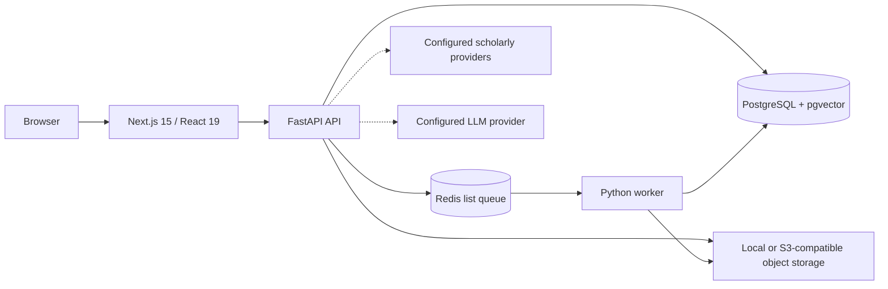

# Current Architecture

## System overview

## Components and current boundaries

- **Web:** `apps/web/` contains the Next.js App Router pages, shared UI components, and a typed fetch helper. Analysis routes use a shared research-tool component.
- **API:** `apps/api/app/main.py` owns FastAPI routes, request models, middleware, and much of the use-case orchestration. This module is larger than the intended thin-route boundary and is a future modularization candidate.
- **Persistence:** `apps/api/app/models.py` defines SQLAlchemy models. Alembic migrations live in `infra/migrations/`. PostgreSQL stores authoritative metadata and pgvector embeddings for indexed chunks.
- **Queue and worker:** `apps/api/app/services/queue.py` pushes JSON payloads to a Redis list. `apps/worker/app/worker.py` consumes jobs and handles PDF extraction/indexing.
- **Object storage:** `apps/api/app/core/storage.py` supports local filesystem and S3-compatible storage. Uploaded bytes are kept outside relational rows.
- **Retrieval and model providers:** `apps/api/app/services/rag.py`, `embeddings.py`, and `reranker.py` implement chunking, hybrid retrieval, embedding adapters, and optional reranking. The observed local default is deterministic feature hashing, not a pretrained scientific-paper model.
- **Corpus:** the processed local corpus is `data/processed/arxiv_papers.jsonl`; raw and generated datasets are ignored by Git. External provider integrations are in `apps/api/app/providers/scholarly.py`.

## Data flow: private PDF

1. Authenticated client uploads a PDF to `POST /api/papers/upload`.
2. The API validates and stores the file, creates paper/document/job records, then pushes a job payload to Redis.
3. The worker retrieves the binary, extracts and normalizes text, chunks it, generates embeddings, persists chunks, and records status.
4. Q&A retrieves indexed evidence and returns source metadata with the answer or an evidence-limited response.

The current Redis `BLPOP` flow removes a job before processing and does not provide acknowledgements or an explicit retry/dead-letter lifecycle. Worker-crash recovery is therefore a priority.

## Data flow: discovery and analysis

The API combines local-corpus lookup with configured scholarly providers. Search filters/pagination are limited. Cross-paper analysis accepts a bounded list supplied by the frontend and may call an LLM; the strength of the output depends on the supplied metadata/abstracts and provider response.

## Deliberate current decisions

- Keep Next.js rather than migrate to Vite to preserve the existing working frontend; see [ADR 0001](ADR/0001-retain-existing-stack.md).
- Keep PostgreSQL as the source of truth and pgvector for indexed chunks.
- Keep the Redis queue and worker for non-blocking ingestion while planning durable delivery semantics.
- Keep local embedding fallback for offline development, but do not describe it as semantic model quality.

## Important constraints

- API paths are `/api/...`, not yet `/api/v1/...`.
- The default hashing vectors do not provide semantic embeddings; model identity/version is not fully represented in stored vectors.
- OCR, full production observability, rate limiting, backup/restore validation, and production deployment validation are absent or unverified.
- `apps/worker/app/pipelines/` contains process documentation, not the executable pipeline implementation; the active worker logic is in `worker.py`.

See [PROJECT_REVIEW.md](PROJECT_REVIEW.md) for verified gaps and [IMPLEMENTATION_PLAN.md](IMPLEMENTATION_PLAN.md) for the next work.
